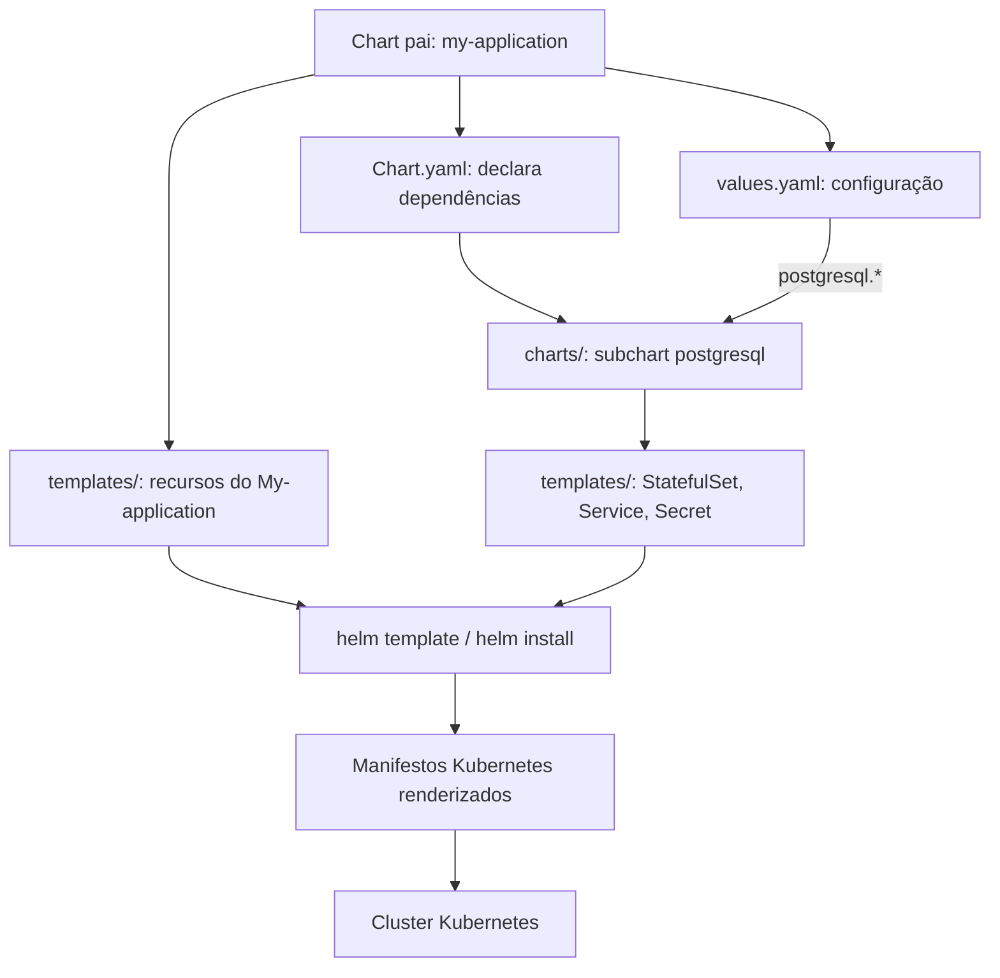
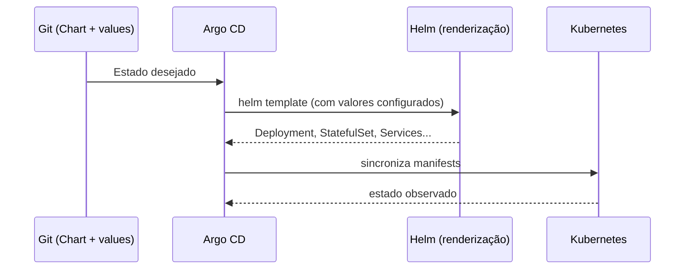

# Helm Subcharts — como tudo se conecta

> Guia prático para entender **chart pai**, **dependências**, **subcharts**, **values**, **aliases** e a renderização final no Kubernetes.

## 1. Modelo mental



Um **subchart é um chart Helm completo usado como dependência de outro chart**. O chart pai pode instalar seu aplicativo e, no mesmo release, componentes auxiliares como PostgreSQL, Redis ou outro serviço.

**Importante:** um subchart não é um Pod dentro de outro Pod. Ele gera seus **próprios recursos Kubernetes**, que pertencem ao mesmo *release* Helm do chart pai (em uma instalação comum).

## 2. Estrutura típica

```text
my-application/                         # chart pai
├── Chart.yaml                 # metadados + dependências
├── Chart.lock                 # versões resolvidas (após dependency update)
├── values.yaml                # valores padrão do pai e overrides dos filhos
├── charts/                    # charts dependentes baixados/empacotados
│   └── postgresql-16.x.x.tgz  # subchart, exemplo ilustrativo
└── templates/
    ├── deployment.yaml        # recursos do My-application
    ├── service.yaml
    └── _helpers.tpl

# Dentro do pacote postgresql-16.x.x.tgz existe outro chart:
postgresql/
├── Chart.yaml
├── values.yaml
└── templates/
    ├── primary/statefulset.yaml
    ├── primary/svc.yaml
    └── ...
```

O subchart pode estar em `charts/` como arquivo `.tgz` ou como diretório. O pacote é obtido a partir do `repository` e `version` definidos em `Chart.yaml`.

## 3. Exemplo completo: My-application depende de PostgreSQL

**`Chart.yaml` do pai:**

```yaml
apiVersion: v2
name: my-application
version: 1.0.0
appVersion: "2.3.0"
dependencies:
  - name: postgresql
    version: "16.4.0"       # exemplo: confira versão disponível no repositório
    repository: "https://charts.bitnami.com/bitnami"
    condition: postgresql.enabled
```

**`values.yaml` do pai:**

```yaml
replicaCount: 2
image:
  repository: minha-org/my-application
  tag: "2.3.0"

postgresql:
  enabled: true
  auth:
    username: my-application
    database: my-application_db
    existingSecret: my-application-db-credentials
  primary:
    persistence:
      enabled: true
      size: 8Gi
```

A chave **`postgresql:`** identifica os valores enviados ao subchart `postgresql`. As chaves internas (`auth`, `primary` etc.) têm de existir no contrato de `values.yaml` daquela **versão específica do subchart**. `existingSecret` requer que o Secret apropriado exista com as chaves esperadas pelo chart dependente; não é criado automaticamente pelo exemplo.

**`templates/deployment.yaml` do pai (trecho):**

```yaml
apiVersion: apps/v1
kind: Deployment
metadata:
  name: {{ .Release.Name }}-my-application
spec:
  replicas: {{ .Values.replicaCount }}
  selector:
    matchLabels: {app: my-application}
  template:
    metadata:
      labels: {app: my-application}
    spec:
      containers:
        - name: my-application
          image: "{{ .Values.image.repository }}:{{ .Values.image.tag }}"
          env:
            - name: DB_HOST
              value: "{{ .Release.Name }}-postgresql" # nome usual; valide no subchart
```

O `Deployment` pertence ao pai. O `StatefulSet`/`Service` do PostgreSQL são gerados pelos templates do filho. A referência de `DB_HOST` deve corresponder ao nome real do Service renderizado (que pode mudar por `fullnameOverride`, alias e regras do chart).

## 4. Quem enxerga quais valores?

```text
values.yaml (pai)
├── replicaCount: 2            ───> templates/ do My-application: .Values.replicaCount
├── image: {...}               ───> templates/ do My-application: .Values.image
├── postgresql:                ───> values do subchart PostgreSQL
│   ├── enabled: true
│   └── auth:
│       └── username: my-application    ───> templates/ PostgreSQL: .Values.auth.username
└── global:
    └── environment: dev       ───> acessível como .Values.global.environment
                                       no pai e nos filhos
```

**Regras de escopo:**

- Templates do pai enxergam seus valores em `.Values.*`, incluindo `.Values.postgresql.*`.
- Templates do filho enxergam **os valores do filho**, já ajustados pelos overrides do pai: no PostgreSQL é `.Values.auth.username`, **não** `.Values.postgresql.auth.username`.
- O filho **não tem acesso irrestrito** aos demais valores do pai; `global:` serve para compartilhar configuração explicitamente.
- O mesmo valor pode vir de `values.yaml` padrão, de arquivos `-f` ou de `--set`; os overrides são mesclados conforme as regras do Helm.

## 5. Quando uso `helm dependency update`?

```bash
# Na pasta do chart pai:
helm dependency update ./my-application
# Resolve dependências de Chart.yaml, atualiza Chart.lock e baixa para charts/

helm dependency build ./my-application
# Reconstitui charts/ com base nas versões travadas em Chart.lock

helm template teste ./my-application -f ./my-application/values.yaml
# Inspeciona os manifestos gerados, SEM aplicar no cluster

helm install teste ./my-application -n dev --create-namespace
# Cria um release no cluster

helm upgrade teste ./my-application -n dev -f ./my-application/values-prod.yaml
# Atualiza o release usando overrides
```

**Diferença essencial:** `Chart.yaml` declara a dependência e seu intervalo/versão; `Chart.lock` registra versões resolvidas para reprodução; `charts/` contém as dependências disponíveis localmente.

## 6. Habilitar/desabilitar o subchart

```yaml
# values-dev.yaml
postgresql:
  enabled: true

# values-prod.yaml
postgresql:
  enabled: false
```

Com `condition: postgresql.enabled` na dependência, `false` impede que o subchart seja renderizado. Um cenário comum: **PostgreSQL local/dev via subchart**, mas **Aurora/RDS externo em produção**. Nesse caso, o chart My-application continua sendo aplicado, e suas configurações de conexão precisam apontar para o banco externo.

## 7. `alias`: mesma dependência, mais de uma instância

```yaml
# Chart.yaml
 dependencies:
   - name: redis
     alias: cache
     version: "20.0.0"  # ilustrativa
     repository: "https://charts.bitnami.com/bitnami"
   - name: redis
     alias: sessions
     version: "20.0.0"
     repository: "https://charts.bitnami.com/bitnami"
```

```yaml
# values.yaml do pai
cache:
  architecture: standalone
sessions:
  architecture: standalone
```

Com alias, as chaves `cache:` e `sessions:` controlam instâncias independentes do mesmo chart (atenção a nomes e recursos efetivamente gerados).

## 8. Argo CD com Helm: quem faz o quê?



Quando o Argo CD usa Helm como fonte, ele **renderiza os templates e gerencia a sincronização**, em vez de utilizar necessariamente `helm install`/`helm upgrade` como controlador do release. As dependências precisam estar acessíveis no processo de renderização (vendorizadas em `charts/` ou obtidas conforme a configuração do ambiente).

## 9. Erros comuns

| Sintoma | Possível causa | Onde olhar |
|---|---|---|
| `found in Chart.yaml, but missing in charts/` | dependência não baixada | `helm dependency build/update` |
| Mudei `postgresql.auth.*` e nada aconteceu | chave incompatível com a versão do filho | `helm show values <chart>` + `helm template` |
| Filho não foi instalado | `condition` desabilitada | `postgresql.enabled` |
| My-application não resolve host do DB | Service tem nome diferente do esperado | `helm template` e `kubectl get svc` |
| Aplicação subiu antes do banco ficar pronta | recursos não garantem prontidão automática entre si | readiness probes e retries da app |
| Quero atualizar só PostgreSQL | subchart faz parte do mesmo release | upgrade do chart pai (ou releases separados) |

## 10. Checklist para estudar na prática

1. Crie um chart com `helm create my-application` e inspecione seus arquivos.
2. Adicione uma dependência com versão verificada em `Chart.yaml`.
3. Execute `helm dependency update` e veja `Chart.lock` + `charts/`.
4. Inspecione o `values.yaml` do subchart e coloque overrides sob `postgresql:`.
5. Rode `helm template demo ./my-application > rendered.yaml` e encontre os `kind:` produzidos por pai e filho.
6. Altere `postgresql.enabled` para `false` e compare o resultado.
7. Experimente um arquivo `values-prod.yaml` com `-f`.

---

### Resumo em uma frase

**Chart pai declara os subcharts em `Chart.yaml`, fornece seus overrides em `values.yaml`, Helm reúne todos os templates em um conjunto de manifestos, e Helm ou Argo CD os encaminha ao Kubernetes conforme o modo de deploy.**

Documentação oficial: https://helm.sh/docs/chart_template_guide/subcharts_and_globals/ · https://helm.sh/docs/helm/helm_dependency/ · https://argo-cd.readthedocs.io/en/stable/user-guide/helm/
