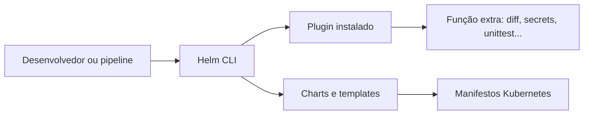
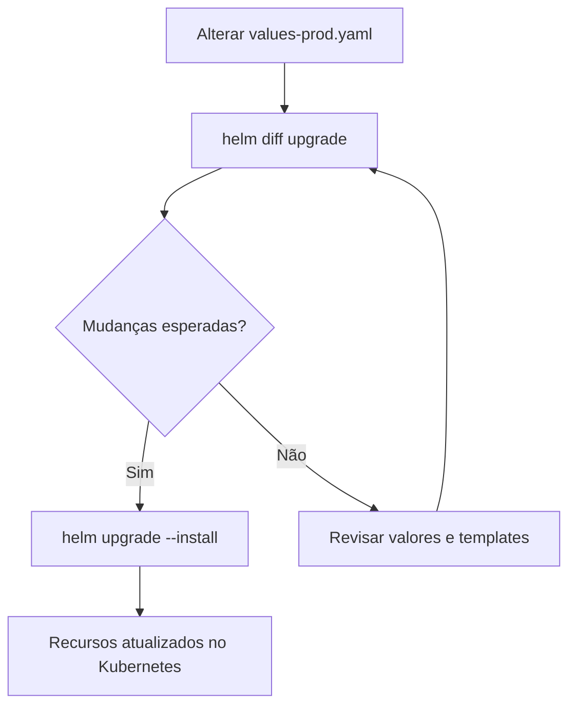

# Helm Plugins — Guia rápido

## O que são?

**Plugins são extensões da CLI do Helm.** Eles acrescentam subcomandos e funcionalidades sem modificar os arquivos do chart nem o Helm core.

> **Não confundir:** um **subchart** é uma dependência de um chart, usada na renderização de recursos Kubernetes. Um **plugin** amplia os comandos disponíveis na máquina/ambiente que executa Helm.

## Como tudo se conecta



- O Helm descobre plugins instalados e disponibiliza seus subcomandos, como `helm diff`.
- Ao executar o subcomando, a implementação do plugin roda (por exemplo, um executável ou script).
- O plugin pode analisar charts, chamar outras ferramentas ou interagir com o cluster, dependendo da sua finalidade.
- Plugins **não são instalados dentro dos pods** por padrão. Eles ficam no ambiente em que a CLI é executada, como sua máquina ou um runner de CI.

## Exemplos úteis

| Plugin | Para que serve | Exemplo |
|---|---|---|
| `helm-diff` | Mostra diferenças entre o release atual e uma atualização proposta | `helm diff upgrade my-application ./chart -f values-prod.yaml` |
| `helm-secrets` | Integra fluxos de arquivos de valores criptografados, normalmente com SOPS | `helm secrets upgrade my-application ./chart -f secrets.yaml` |
| `helm-unittest` | Testa os templates renderizados do chart | `helm unittest ./chart` |
| `helm-s3` | Permite usar repositórios clássicos de charts armazenados no S3 | `helm s3 init s3://meu-bucket/charts` |

*Os comandos pressupõem que o respectivo plugin já esteja instalado. Sintaxe e opções podem variar conforme a versão.*

## Instalação e gerenciamento

```bash
# Ver plugins instalados
helm plugin list

# Instalar helm-diff (projeto oficial do plugin)
helm plugin install https://github.com/databus23/helm-diff

# Remover
helm plugin uninstall diff

# Ver ajuda específica
helm diff --help
```

Para produção, prefira versões fixas dos plugins e verifique compatibilidade com a sua versão do Helm.

## Exemplo prático: antes do deploy



```bash
helm diff upgrade my-application ./chart -f values-prod.yaml
helm upgrade --install my-application ./chart -f values-prod.yaml
```

Esse exemplo é de execução pela CLI; **se você usa Argo CD**, em geral o Argo CD renderiza o chart e faz a sincronização diretamente. Ter `helm-diff` instalado no notebook **não faz o Argo CD usar esse plugin**. Para executar plugins em pipelines ou em ambientes controlados pelo Argo CD, é necessária uma integração/configuração explícita no ambiente adequado.

## Plugins vs. charts vs. subcharts

| Conceito | Papel | Onde entra |
|---|---|---|
| Chart | Empacota templates e configurações de uma aplicação | `Chart.yaml`, `values.yaml`, `templates/` |
| Subchart | Chart dependente de outro chart | `Chart.yaml` em `dependencies` e `charts/` |
| Plugin | Extende os comandos/capacidades da CLI Helm | Instalado separadamente, fora da estrutura normal do chart |

### Resumo em uma frase

**Chart descreve o que implantar; subchart reutiliza um chart dependente; plugin acrescenta ferramentas ao Helm para trabalhar com charts e releases.**
