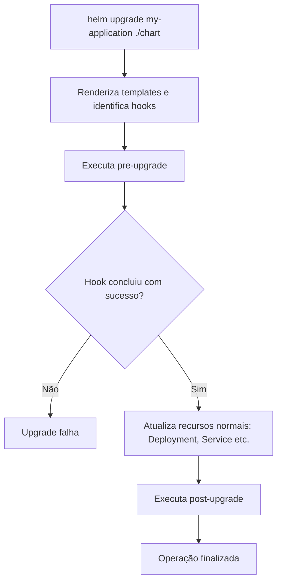

# Helm Chart Hooks — guia prático

> **Objetivo:** entender quando usar hooks, como eles se encaixam no ciclo de vida de um release e quais cuidados tomar ao utilizar Helm com Argo CD.

## 1. O que é um hook?

Um **Helm Hook** é um recurso Kubernetes (frequentemente um `Job`) que o Helm executa em um **momento específico** do ciclo de vida de uma operação, como instalação, atualização ou remoção de um release.

O hook **não é um script definido no `Chart.yaml`**: é um manifesto em `templates/` identificado por uma anotação no `metadata.annotations`:

```yaml
metadata:
  annotations:
    "helm.sh/hook": pre-upgrade
```

**Exemplo de uso:** executar uma migração de banco antes de atualizar os pods da aplicação.

## 2. Onde entra no fluxo?



**Importante:** esta é uma representação simplificada. O Helm ordena hooks por peso/tipo/nome, espera Jobs e Pods de hook concluírem e o comportamento de espera de outros recursos pode depender das flags como `--wait`.

## 3. Principais tipos

| Hook | Quando ocorre | Exemplo |
|---|---|---|
| `pre-install` | Antes de instalar os recursos comuns | Preparar dados iniciais |
| `post-install` | Após instalar recursos comuns | Teste ou bootstrap |
| `pre-upgrade` | Antes de atualizar recursos comuns | Migração de schema |
| `post-upgrade` | Após atualizar recursos comuns | Verificação pós-deploy |
| `pre-rollback` | Antes de um rollback | Preparar reversão |
| `post-rollback` | Após um rollback | Verificação de retorno |
| `pre-delete` | Antes da remoção do release | Limpeza controlada |
| `post-delete` | Após a remoção | Limpeza final |
| `test` | Ao executar `helm test` | Teste de conectividade |

Um mesmo manifesto pode declarar mais de um evento, separados por vírgula: `"helm.sh/hook": pre-install,pre-upgrade`.

## 4. Exemplo: Job de migração antes do upgrade

Estrutura:

```text
my-application-chart/
├── Chart.yaml
├── values.yaml
└── templates/
    ├── deployment.yaml
    ├── service.yaml
    └── migrate-job.yaml    # Hook
```

`templates/migrate-job.yaml`:

```yaml
apiVersion: batch/v1
kind: Job
metadata:
  name: {{ .Release.Name }}-migration
  annotations:
    "helm.sh/hook": pre-upgrade
    "helm.sh/hook-weight": "-5"
    "helm.sh/hook-delete-policy": before-hook-creation,hook-succeeded
spec:
  backoffLimit: 1
  template:
    spec:
      restartPolicy: Never
      containers:
        - name: migrate
          image: "{{ .Values.image.repository }}:{{ .Values.image.tag }}"
          command: ["/app/bin/migrate"] # Exemplo: ajuste ao executável real
```

`values.yaml`:

```yaml
image:
  repository: registry.example.com/my-application
  tag: "1.0.0"
```

Ao rodar `helm upgrade my-application ./my-application-chart -f values-prod.yaml`, o Helm cria o Job de hook e aguarda sua conclusão antes de prosseguir com a atualização dos recursos normais. Se o Job falhar, o upgrade falha. **Isso não significa que mudanças já aplicadas no banco sejam revertidas automaticamente.**

> Para uma aplicação Elixir/Ecto, o comando real de migração precisa existir na sua imagem/release, com configuração de banco e credenciais adequadas. Migrações devem considerar compatibilidade entre versões da aplicação e do schema.

## 5. Anotações essenciais

| Anotação | O que controla |
|---|---|
| `helm.sh/hook` | Evento (`pre-install`, `pre-upgrade` etc.) |
| `helm.sh/hook-weight` | Ordem relativa de execução; pesos menores vêm primeiro |
| `helm.sh/hook-delete-policy` | Quando remover recursos criados por hooks |

Políticas de exclusão comuns:

- `before-hook-creation`: remove uma instância anterior antes de criar o novo hook (comportamento padrão se nenhuma política for definida).
- `hook-succeeded`: remove o recurso após sucesso.
- `hook-failed`: remove o recurso após falha (cuidado: pode dificultar o debug).

**Atenção:** recursos de hooks não são gerenciados da mesma forma que recursos normais do release. Planeje limpeza, logs e retenção. Para Jobs, `ttlSecondsAfterFinished` também pode ser útil, dependendo da estratégia.

## 6. Como testar e debugar

```bash
# Verificar a estrutura e os templates
helm lint ./my-application-chart

# Renderizar os YAMLs localmente
helm template my-application ./my-application-chart -f values-dev.yaml

# Inspecionar hooks de um release já instalado
helm get hooks my-application -n minha-namespace

# Acompanhar um Job criado pelo hook
kubectl get jobs -n minha-namespace
kubectl describe job my-application-migration -n minha-namespace
kubectl logs job/my-application-migration -n minha-namespace
```

`helm template` **apenas renderiza**: não executa hooks nem cria Jobs no cluster. Um `Job` renderizado com anotação de hook continua sendo só YAML até algum controlador ou comando aplicá-lo.

## 7. E com Argo CD?

No fluxo típico de **Argo CD + Helm**, o Helm é usado para **renderizar manifestos**, enquanto **o Argo CD gerencia a aplicação e a sincronização**. O Argo CD tem suporte a vários hooks do Helm, mapeando-os para o próprio mecanismo de hooks (por exemplo, `pre-install`/`pre-upgrade` para `PreSync`, e `post-install`/`post-upgrade` para `PostSync`).

Isso traz diferenças importantes:

- **Não é um `helm upgrade` tradicional**; Argo CD controla quando os recursos são aplicados.
- O Argo CD **não distingue install de upgrade da mesma forma que o Helm** para mapear hooks; revise eventos e política de sincronização.
- Nem todas as anotações e comportamentos de Helm Hooks são equivalentes no Argo CD.
- Para novos manifests destinados exclusivamente ao Argo CD, muitas equipes preferem usar os hooks nativos: `argocd.argoproj.io/hook: PreSync` ou `PostSync`.

Exemplo de anotação nativa do Argo CD:

```yaml
metadata:
  annotations:
    argocd.argoproj.io/hook: PreSync
    argocd.argoproj.io/hook-delete-policy: HookSucceeded
```

**Nunca assuma** que uma migração será executada somente durante upgrades sem verificar como o seu Argo CD interpreta as anotações do chart.

## 8. Quando vale usar — e quando evitar

**Faz sentido:** Jobs curtos, repetíveis e com resultado verificável; tarefas preparatórias; testes de release.

**Evite:** depender de hook para tarefas permanentes, esconder deploys complexos em scripts difíceis de observar ou executar migrações destrutivas sem estratégia de compatibilidade/rollback.

Checklist antes de adicionar um hook:

1. A execução pode acontecer **mais de uma vez** sem quebrar o sistema (idempotência)?
2. O Job tem `backoffLimit`, recursos, timeout/limites e logs adequados?
3. O banco e serviços necessários estarão disponíveis naquele ponto do ciclo?
4. O que acontece se houver falha, retry ou rollback?
5. Quem remove Jobs antigos e preserva evidências de falha?
6. O chart será instalado por **Helm CLI**, **Argo CD** ou ambos?

## 9. Resumo para memorizar

```text
Chart = pacote de manifestos e templates
Values = parâmetros usados na renderização
Subchart = dependência reutilizável (outro chart)
Plugin = extensão da CLI do Helm
Hook = recurso executado em uma etapa do ciclo de vida do release

pre-upgrade -> Job de migração -> Deployment atualizado -> post-upgrade
```

**Para seu roadmap:** conheça os tipos de hooks, faça um único Job de exemplo e siga para CI/CD. Aprofunde quando precisar de migrações e sincronização GitOps no projeto real.

### Referências oficiais

- [Helm — Chart Hooks](https://helm.sh/docs/topics/charts_hooks/)
- [Helm — Chart Template Guide](https://helm.sh/docs/chart_template_guide/)
- [Argo CD — Helm](https://argo-cd.readthedocs.io/en/stable/user-guide/helm/)
- [Argo CD — Resource Hooks](https://argo-cd.readthedocs.io/en/stable/user-guide/resource_hooks/)
